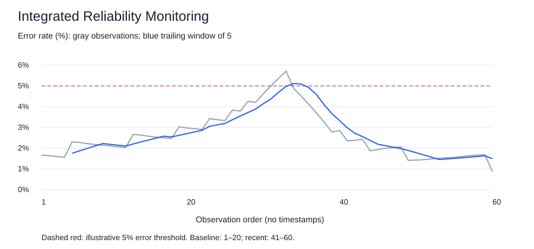

# Integrated System Reliability Monitoring

Continuous Intelligence | Project 06 | Darrion Maurice Stringer

Author: Darrion Maurice Stringer

Date: 2026-11

## Overview

I combined signal design, anomaly detection, rolling monitoring, and baseline comparisons into one reliability assessment.

My question was: Does recent system performance show worsening reliability compared with earlier observations?

## Data

I used the provided dataset containing 60 system observations.

Each record includes:

- requests: number of requests handled.
- errors: number of failed requests.
- total_latency_ms: total response time in milliseconds.

The file has no timestamps. I assume its rows are in observation order.

[View Dataset](https://github.com/dstringer03/cintel-06-continuous-intelligence-custom/blob/main/data/system_metrics.csv)

## Methods

### Signal Design

I reused the existing helper function to calculate:

- Error rate = errors / requests.
- Average latency = total_latency_ms / requests.
- Throughput indicator = requests per observation.

Without measurement intervals, request counts are not a rate per unit of time.

### Anomaly Detection

An observation is flagged when:

- Error rate exceeds 5%, or
- Average latency exceeds 40 milliseconds.

I saved individual anomaly records so they can be reviewed separately from the summary.

### Rolling Monitoring

I reused the rolling-metrics helper and added five-observation rolling averages of error rate and average latency.

Each window uses the current observation and the previous four observations. The first four rolling values are blank because a complete window is not available.

### Baseline and Drift Comparisons

I compared:

- Baseline: the first 20 observations.
- Recent period: the last 20 observations.

I calculated changes in average error rate and average latency.

Illustrative drift thresholds were:

- An absolute error-rate change greater than 1 percentage point.
- An absolute average-latency change greater than 5 milliseconds.

A positive change exceeding either threshold indicates worsening drift. A negative change exceeding the same magnitude would indicate improvement rather than worsening.

These thresholds are demonstration choices, not validated service requirements.

### System Assessment

The custom assessment is DEGRADED if:

- The recent average error rate exceeds 5%.
- The recent average latency exceeds 40 milliseconds.
- The latest five-observation rolling error rate exceeds 5%.
- The latest five-observation rolling latency exceeds 40 milliseconds.
- Worsening drift exceeds either comparison threshold.

Otherwise, the assessment is STABLE.

Historical anomalies are reported separately. Their presence does not automatically make the recent assessment DEGRADED.

### Data Checks

The script checks for required columns, missing values, invalid counts, negative latency, and sufficient observations.

It requires positive request counts before calculating per-request signals.

## D2 Experiment

I added a five-observation rolling error-rate signal to the original pipeline.

I predicted that the first four rolling values would be blank. The results matched that prediction, and the first complete rolling error rate was approximately 1.76%.

The original anomaly count remained 7.

[Read the D2 Experiment](https://github.com/dstringer03/cintel-06-continuous-intelligence-custom/blob/main/README.md#d2-experiment-adding-rolling-error-rates)

## D3 Results

| Measure | Baseline | Recent period |
|---|---:|---:|
| Observations | 20 | 20 |
| Average error rate | 2.26% | 1.75% |
| Average latency | 30.79 ms | 31.18 ms |

Additional results:

- Error-rate change: -0.51 percentage points.
- Average-latency change: +0.39 milliseconds.
- Error-rate drift detected: No.
- Latency drift detected: No.
- Total anomalous observations: 7.
- Anomalies in the recent period: 0.
- Custom system assessment: STABLE.

[View Integrated Signals](https://github.com/dstringer03/cintel-06-continuous-intelligence-custom/blob/main/artifacts/integrated_signals.csv)

[View Individual Anomalies](https://github.com/dstringer03/cintel-06-continuous-intelligence-custom/blob/main/artifacts/integrated_anomalies.csv)

[View Integrated Assessment](https://github.com/dstringer03/cintel-06-continuous-intelligence-custom/blob/main/artifacts/integrated_assessment.csv)

## Interpretation

Recent error rates improved compared with the baseline. Average latency increased slightly, but neither change exceeded the selected drift threshold.

The assessment was STABLE, and the recent period contained no flagged anomalies.

However, seven anomalies occurred elsewhere in the dataset. This shows why the recent assessment should be reviewed alongside the full signal history and individual anomaly records.

The rolling chart helps show changes that a comparison of only the first and last periods could miss.

## Limitations

- The dataset contains only 60 observations.
- No timestamps are available, so row order is assumed to represent sequence.
- The first 20 observations are a chosen reference period, not a verified normal baseline.
- The first-versus-last comparison can miss problems in the middle.
- Rolling averages can smooth brief spikes and delay detection.
- Average observation-level rates give each observation equal weight despite different request counts.
- Thresholds require validation before operational use.
- This is a batch analysis, not a live monitoring or notification service.

## Next Steps

I would add timestamps, collect more data, validate the baseline and thresholds, and compare request-weighted rates.

I would also investigate the anomaly records and consider alerts for sustained problems.

## Run the Project

Run the original pipeline with the D2 rolling addition:

    uv run python -m cintel.continuous_intelligence

Run the custom integrated analysis:

    uv run python -m cintel.integrated_monitor

The custom script creates:

- artifacts/integrated_signals.csv
- artifacts/integrated_anomalies.csv
- artifacts/integrated_assessment.csv
- docs/images/integrated-monitoring.svg

## Verification

The custom script executed successfully and saved the signals, anomaly records, assessment, and chart.

Its assessment reported 7 total anomalies, 0 recent anomalies, and a STABLE system state.

## Project Links

- [My Repository](https://github.com/dstringer03/cintel-06-continuous-intelligence-custom)
- [Custom Analysis Code](https://github.com/dstringer03/cintel-06-continuous-intelligence-custom/blob/main/src/cintel/integrated_monitor.py)
- [Results and Artifacts](https://github.com/dstringer03/cintel-06-continuous-intelligence-custom/tree/main/artifacts)

## Documentation Index

- [Project Instructions](project-instructions.md)
- [Glossary](glossary.md)
- [API](api.md)
- [Reactive App](./app/index.html)

## Resources

Based on the example project by Denise Case.

- [Original Example](https://github.com/denisecase/cintel-06-continuous-intelligence)
- [Professional Python Guide](https://denisecase.github.io/pro-analytics-02/)
